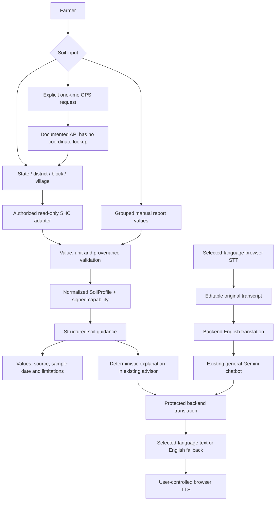

# KrishiMitra soil and voice implementation report

Date: 26 September 2026. Implemented in the existing repository; the existing product spelling, stack, crop-health behavior, database schema and migrations are preserved.

**27 September follow-up:** [speech failure fix and local report import](speech-and-report-import.md) supersedes the browser-only STT architecture and adds photo/PDF import plus reusable named reports without a government API key. The earlier sections below describe the initial implementation; consult the follow-up and current setup guide for the updated flow.

## 1. Repository analysis

| Area | Existing implementation and findings |
| --- | --- |
| Frontend | React 18, TypeScript, Vite 6, Tailwind and TanStack Query. One `App.tsx` contained navigation, image upload and chatbot. No router library, authentication UI, frontend tests, service worker or dedicated soil screen. |
| Backend | FastAPI/Pydantic, synchronous SQLAlchemy sessions and psycopg; versioned `/api/v1` routers. Leaf inference was invoked synchronously inside an async endpoint. External Gemini calls and frontend calls lacked explicit timeouts. |
| Database | PostgreSQL 16 + pgvector; Alembic creates model registry, disease scans, knowledge documents/chunks and advisor conversations/messages/citations. No soil history/account/ownership tables. The knowledge schema is present but retrieval is not wired into the chatbot. |
| Existing ML | MobileNetV2 on a 10-label PlantVillage subset, with training/preprocessing/split scripts and stored metadata. The checkpoint and raw dataset are Git-ignored and absent from this worktree. No tabular soil or crop-suitability dataset/model exists. |
| Existing chatbot | Backend Gemini call, eight recent canonical messages as context, PostgreSQL storage. A conversation UUID could be supplied without proof of ownership. No speech or translation layers. |
| Module 2 before changes | Absent from routes, UI and services. There was no existing crop recommendation engine to connect or preserve. |
| Configuration | Backend `.env`, public frontend API URL, exact development CORS origins, Windows launch scripts and a database-only Compose service. No committed production token was needed or added. |

Inspection covered application routes/services, models, session handling, migrations, tests, frontend configuration/screens/styles, training/data scripts, launch scripts, dependency manifests, data-source registers and architectural handoff documentation. Existing generated Word/PowerPoint assets were not rewritten.

## 2. Final architecture and behavior

There is one backend recommendation/guidance module. It returns missing-parameter information, practical next steps and limitations; it does not invent suitability scores, nutrient classes or fertilizer doses. Soil explanation is deterministic from the signed values and those steps, rather than asking an LLM to create measurements. General farming questions still use the existing Gemini advisor. The user can leave soil explanation mode for general chat.

Manual and government profiles use the same typed structure. `GOVERNMENT_VERIFIED`, `USER_ENTERED` and `AI_ESTIMATED` are distinct classifications and badges. The estimate badge/mandatory warning are supported, but no untrained estimate path is advertised. Test fixtures are clearly synthetic and never substituted for missing government data.

## 3. Important file changes

| Status | File | Purpose |
| --- | --- | --- |
| Created | `backend/app/modules/soil/__init__.py` | Soil package |
| Created | `backend/app/modules/soil/models.py` | Typed profiles, all 12 parameters, units, source and validation |
| Created | `backend/app/modules/soil/service.py` | Official GraphQL adapter, token renewal, directory validation, normalization, cache and safe failures |
| Created | `backend/app/modules/soil/recommendations.py` | Shared deterministic guidance and soil explanation |
| Created | `backend/app/api/v1/endpoints/soil.py` | Manual, lookup, directory, parameter and isolated demo routes |
| Created | `backend/app/core/security.py` | Purpose-scoped, expiring HMAC capabilities for profiles and chat continuation |
| Created | `backend/app/core/middleware.py` | Bounded request/rate limits and structured event formatter |
| Created | `backend/app/modules/advisor/translation.py` | Translation-provider interface and Gemini implementation with protected values |
| Created | `backend/scripts/train_soil.py` | Reproducible geographic classification comparison pipeline |
| Created | `backend/tests/test_soil.py` | Domain/provider/API/cache/authentication/units/missing-data tests |
| Created | `backend/tests/test_voice_security.py` | Four-language canonical flow, translation failures, capabilities and soil explanation tests |
| Created | `backend/tests/test_hardening.py` | Decoder, rate limit and safe database error regression tests |
| Created | `backend/tests/test_soil_training.py` | Duplicate leakage checks and synthetic training-pipeline smoke test |
| Created | `backend/tests/conftest.py` | Isolated rate-limit state for tests |
| Created | `frontend/src/components/SoilHealth.tsx` | Two prominent soil paths, directory form, grouped manual input, consented drafts and result cards |
| Created | `frontend/src/components/Advisor.tsx` | Extracted existing chatbot with translation, correction/retry, voice and signed soil context |
| Created | `frontend/src/components/Voice.tsx` | Reusable recording/playback controls |
| Created | `frontend/src/services/speech.ts` | STT provider boundary, watchdog, GPS utility and TTS lifecycle |
| Created | `frontend/src/services/api.ts` | Bounded JSON requests, consistent UI errors and storage helpers |
| Created | `frontend/src/i18n.tsx` | Four locales and translated core controls/help |
| Created | `frontend/src/test/setup.ts`, `soil.test.tsx`, `speech.test.tsx`, `advisor.test.tsx` | Component/service regression coverage |
| Created | `frontend/vitest.config.ts` | Browser-like test environment |
| Created | `docs/soil-and-voice-setup.md`, this report | Operations, official contract, architecture, limitations and evidence |
| Modified | `backend/app/api/v1/router.py` | Register soil routes |
| Modified | `backend/app/api/v1/endpoints/advisor.py` | Capability checks, language/transcript handling, soil context and translation-only retry |
| Modified | `backend/app/modules/advisor/service.py` | SDK timeout/retry bound, client cleanup, safer instructions and quantity guard |
| Modified | `backend/app/api/v1/endpoints/crop_health.py` | Bounded upload read, threadpool inference, optional-model failure handling and transaction scope |
| Modified | `backend/app/modules/crop_health/service.py` | Lazy ML imports, explicit image formats and pixel limits |
| Modified | `backend/app/db/database.py` | PostgreSQL connection/query timeouts |
| Modified | `backend/app/core/config.py`, `backend/.env.example` | Soil settings and signing-secret configuration |
| Modified | `backend/app/main.py` | Limited CORS, production configuration guards, logging and sanitized unexpected errors |
| Modified | `backend/pyproject.toml` | Runtime HTTP dependency, security patch constraints, function-scope dependency support and lightweight soil-ML extra |
| Modified | `frontend/src/App.tsx` | Soil navigation, language picker, lazy screens, farmer-focused dashboard, timed leaf request and image URL cleanup |
| Modified | `frontend/src/styles.css` | Responsive cards/forms, readable states, focus contrast and touch targets |
| Modified | `frontend/package.json`, `frontend/package-lock.json` | Patched frontend test tooling and test/typecheck commands |
| Modified | `frontend/.env.example` | Public-URL guidance and explicit prohibition on browser secrets |
| Modified | `compose.yaml` | Bind the local database only to loopback |
| Modified | `README.md` | Current capabilities, access limits and setup/report links |
| Deleted | None | Old inline advisor code was replaced by the extracted component, not removed as a feature |

## 4. Government integration

The [official API guidelines](https://soilhealth.dac.gov.in/files/SHC_API_Integration_Guidelines.pdf) were downloaded and inspected. The adapter uses the documented production GraphQL endpoint, access/refresh-token mechanism, state/district/subdistrict/village directory operations and authorized card retrieval. It does not scrape HTML or use undocumented public portal internals.

Live access is **not verified**. This worktree has no issued SHC credentials. The document's JSON directory/result units are incompletely specified; the strict adapter requires issuer-confirmed mappings and rejects ambiguity. No claim is made that setting a token alone guarantees production compatibility. The [setup guide](soil-and-voice-setup.md) contains the exact operations, result-key mapping, validation contract, bounded cache and acceptance steps.

Location retrieval is opt-in and one-time. Actual GPS-to-record lookup remains unavailable because there is no documented coordinate operation or approved reverse-geographic dataset. Users receive a manual location/manual soil fallback. Government results represent an area sample, carry source/date/coverage labels and are never described as the farmer's exact current field condition. Empty results are distinct from upstream failures; both preserve manual entry.

## 5. ML report

| Item | Result |
| --- | --- |
| Dataset available for soil | None |
| Soil model deployed | None; no nutrient estimate or inference endpoint enabled |
| Offline candidate pipeline | Random Forest vs Histogram Gradient Boosting, using existing scikit-learn |
| Task | Classification against a reviewed user-supplied target, e.g. crop suitability |
| Preprocessing | Numerical features; reject invalid/duplicate/leaky rows; median imputation fitted per fold |
| Missing values | Reject samples over 25% missingness; reject development features entirely missing |
| Validation | Seeded held-out geographic groups; GroupKFold within remaining groups |
| Selection | Mean validation macro-F1, never test-set tuning |
| Saved metrics | Candidate accuracy/macro precision/recall/F1; selected model's independent test classification report and confusion matrix |
| Saved artifacts | Preprocessing+model pipeline, feature order, dataset checksum/citation, seed, versions and evaluation metadata |
| Real agricultural metrics / winner | Not available; reporting a winner or accuracy would be fabricated |
| Software verification | Synthetic pipeline smoke test only; no agricultural inference from its scores |

Regression, nutrient estimation and fertilizer prediction were not introduced without labeled data and method/unit provenance. XGBoost/LightGBM/CatBoost were not added without evidence that extra dependencies are justified. The existing leaf classifier remains unchanged in labels/checkpoint design; the earlier documented PlantVillage score is historical and was not revalidated on real field data here.

## 6. Voice system

Browser STT and TTS are behind reusable services. The chosen locales are `en-IN`, `hi-IN`, `ta-IN`, `te-IN`; recognition is editable before submission. Gemini translates the original input to canonical English and the answer back to the selected language. Protected placeholders preserve quantities and recognized technical terms; failed output translation displays English with a translation-only retry button.

Users start audio themselves. Permission denial, unsupported browsers, missing device voices, noisy/no speech, network failure and a 30-second recording timeout have text fallbacks. Pause/resume is exposed where the browser implements it. Browser vendor audio processing and internet dependence are disclosed before recording. No backend audio storage or additional paid speech provider was added. Voice-provider replacement and translation-provider interfaces allow future provider changes without rebuilding the screens.

Live recognition accuracy and translated agronomic meaning have not been measured on Hindi/Tamil/Telugu farmer recordings. Browser service tests use mocks, so this is functional coverage, not a claim of field speech accuracy.

## 7. Bugs and security findings

| Bug | Severity | Cause | Fix | File | Status |
| --- | --- | --- | --- | --- | --- |
| Conversation could be continued using its UUID alone | High | No ownership/capability check | Require an expiring signed capability tied to the conversation | `core/security.py`, `endpoints/advisor.py` | Fixed for anonymous sessions; full accounts/retention policy remain deployment work |
| Large/unsupported image content reached unrestricted decoders | High | MIME trusted, full read before byte check, no explicit decoder allowlist | Stream/body limit, bounded read, PNG/JPEG/WebP decoder allowlist and pixel limit | `endpoints/crop_health.py`, `crop_health/service.py`, `core/middleware.py` | Fixed |
| Pillow versions with published decoder vulnerabilities were allowed | High | `pillow<12` prevented patched releases | Require Pillow ≥12.3; retain decoder restrictions | `pyproject.toml` | Fixed; clean audit |
| No quota protection for paid operations | High | Unauthenticated requests had no rate limit | Bound per-IP POST/directory requests and memory usage | `core/middleware.py` | Local safeguard fixed; distributed quota/auth required for scale |
| External/DB calls could remain pending too long | Medium | No explicit timeouts | HTTP/SDK/DB timeouts; SDK attempts bounded; UI retry keeps input | services, DB, frontend API helper | Fixed |
| Leaf inference blocked the async server loop | Medium | Synchronous CPU inference inside async endpoint | Execute inference in threadpool | `endpoints/crop_health.py` | Fixed |
| Success could be sent before database commit | High | Yield dependency finalized after response | Function-scoped session dependency commits before returning response | advisor/crop endpoints | Fixed |
| Database port exposed beyond the local machine | High | Compose bound all interfaces | Bind `127.0.0.1:5432` | `compose.yaml` | Fixed in configuration; existing running containers need recreation to apply |
| ML optional dependencies were effectively mandatory at startup | Medium | Top-level Torch imports | Load ML packages only during inference | `crop_health/service.py` | Fixed; clean non-Torch startup tested |
| Selected image URLs leaked | Low | Object URLs were never revoked | Revoke on file replacement/unmount | `App.tsx` | Fixed |
| Whitespace-only questions passed validation | Low | Length checked before trimming | Trim and require meaningful content | `endpoints/advisor.py` | Fixed |
| Failed questions disappeared | Medium | Input cleared before server success | Preserve and edit failed drafts; clear only after success | `components/Advisor.tsx` | Fixed |
| 15-second background health polling used repeated rural bandwidth | Low | Fixed polling interval | Stale-time caching, no periodic/window-focus polling | `App.tsx` | Fixed |
| Narrow-screen horizontal scrolling | Medium | Hard 320px body minimum plus scrollbar width | Flexible body width and wrapping | `styles.css` | Fixed; verified in browser |
| Test dependencies had published advisories | Medium | Older Vitest/pytest and bundled pip | Patched Vitest ≥4.1.11, pytest ≥9.0.3, upgraded local pip | manifests / local toolchain | Fixed; clean audits |
| Unvalidated fertilizer quantities could be generated | High | General LLM free-form output | Deterministic soil explanation; no dose engine; stronger prompt and numerical-quantity rejection for general chat | soil recommendations / advisor service | Soil path fixed; general LLM output still requires expert review |

Additional review: SQLAlchemy queries use bound expressions, user-supplied GraphQL is not accepted, upstream hosts are restricted, CORS origins are explicit, and unexpected errors return generic messages. JSON event logs use fixed event names and safe codes/timing rather than request contents, coordinates or secrets. These changes are not a penetration-test certification. Request quotas/cache are per process; chat capabilities are bearer credentials rather than a full account system.

## 8. UI/UX review

- Soil choices appear before forms. Government-unavailable and empty-result states lead to manual entry.
- Nutrients are grouped, with secondary nutrients collapsed. Values and units are adjacent, decimals are accepted, blank is explicitly unknown, and consented drafts have a clear erase action.
- Results show source badges, individual values/units, sample/retrieval dates, location and area-sample limitations. No unsupported traffic-light fertility judgment is displayed.
- Core soil navigation, parameter labels, help and voice controls support four languages. Long regional-language text wraps, touch targets are at least 44px, and keyboard focus is visible.
- Voice has recording state, Stop/Cancel, editable text and explicit playback controls. Failed translation/voice does not discard the answer.
- The dashboard now leads with soil/crop/questions rather than a review-build technical summary. Heavy screens load lazily, with no new production frontend dependencies or image downloads.
- Full localization of secondary/error/crop-health copy, native-speaker review and testing with elderly/low-literacy farmers remain necessary. No weather, market, irrigation reminder or fake crop ranking was added without data.

## 9. Remaining practical improvements

| Priority / timing | Feature / problem solved | Farmer benefit | Required data or access | Complexity |
| --- | --- | --- | --- | --- |
| Must have before government launch | Validate issued SHC access, payloads, directory relationships, units and disclosure terms | Real measured values with trustworthy provenance | Authority-approved credentials, payload examples and unit/test-method definitions | Medium |
| Must have before public production | Deployment authentication/abuse controls, shared quotas, retention and deletion policy | Protects farmer conversations and service availability | Hosting architecture, owner decisions and user/session policy | Medium–High |
| Must have before claiming four-language release | Complete secondary/error/crop-screen localization and native-speaker voice/translation acceptance | Understandable guidance for regional-language users | Reviewed translations and representative device/audio tests | Medium |
| Should have next | Consented soil-test history with owner access | Compare changes across seasons without losing reports | Account model, storage consent, date/method/unit metadata | Medium |
| Should have once authorized | Coordinate → administrative lookup | Less typing for farmers | Approved geocoding/geographic data and privacy contract | Medium |
| Should have once validated | Source-linked local STCR/GFR fertilizer rules | Avoid wasted inputs and unsafe generic quantities | Crop, season, target yield, validated local equations and measurement methods | High |
| Should have later | Offline/PWA shell with versioned assets | Reopen saved forms during outages | Cache/update strategy and shared-device privacy design | Medium |
| Future, after data collection | Crop suitability using soil/season/weather | Better crop selection under local conditions | Labeled geographically diverse data and reliable weather source | High |
| Future, after validation | ML soil estimates | Transparent provisional information where tests are absent | Representative labeled samples, spatial/temporal evaluation and uncertainty calibration | High |
| Future, only with reliable inputs | Irrigation reminders and weather-aware advice | More timely field work | Farm/crop stage, soil moisture/weather and opt-in notification channel | High |
| Existing module, later improvement | Field-photo leaf model validation | Fewer confident but wrong disease labels | Consented field images, unknown/negative classes and calibration | High |

Implemented now: manual normalized soil entry, authorized-service adapter, source distinction, structured safe guidance, consented drafts, speech/translation/TTS flows and resilience/security fixes. Deferred features are not represented by working-looking fake data.

## 10. Validation and setup

The [setup guide](soil-and-voice-setup.md) covers installation, database/migrations, all environment variables, official access, unit mapping, ML experiment commands, voice providers, production build and tests. Existing `.env` files were not read/copied into the frontend or committed.

Verification performed:

- Original baseline: 8 backend tests passed before editing.
- Expanded backend suite: 47 tests, including actual local domain/API behavior, mocked provider responses and a synthetic model-pipeline smoke test.
- Frontend suite: 18 component/service tests across soil/manual entry, directory failure, drafts, all language locales, speech errors, GPS denial, missing voices and translation retry.
- TypeScript checking and Vite production build passed. No separate existing lint command was present.
- Fresh `npm ci` and fresh Python virtual-environment install succeeded. `npm audit` and `pip-audit` reported no known vulnerabilities after the dependency updates. These are point-in-time audit results, not a guarantee of security.
- Live browser → FastAPI manual pH submission produced the correct value, unit and `USER_ENTERED` badge. Soil-to-advisor navigation worked. Mobile layouts and translated controls were inspected at 360px and 320px; the narrow-layout issue was corrected.

Limits of verification: no live issued SHC credentials, Gemini key, farm-specific recommendation dataset or leaf checkpoint was available in this worktree. External provider tests are mocked. No real farmer audio/production microphone test, production database migration/backup exercise, or agronomic field trial was performed. Browser local soil entry worked without a database; advisor storage requires the existing PostgreSQL setup. No real soil-model accuracy metrics are claimed.
