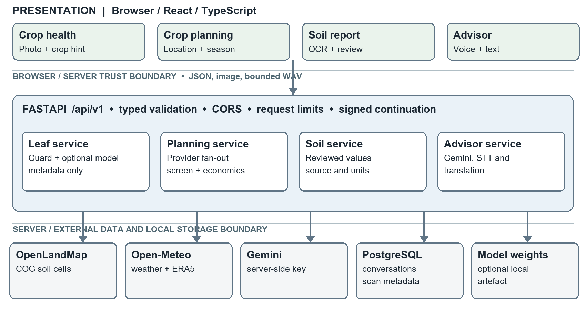
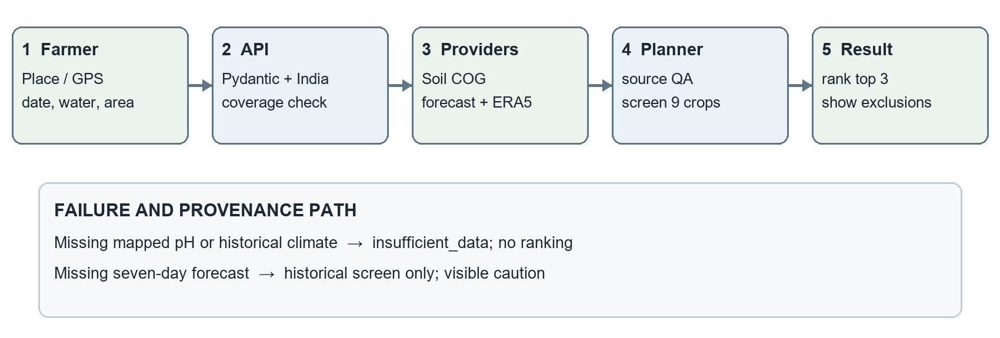
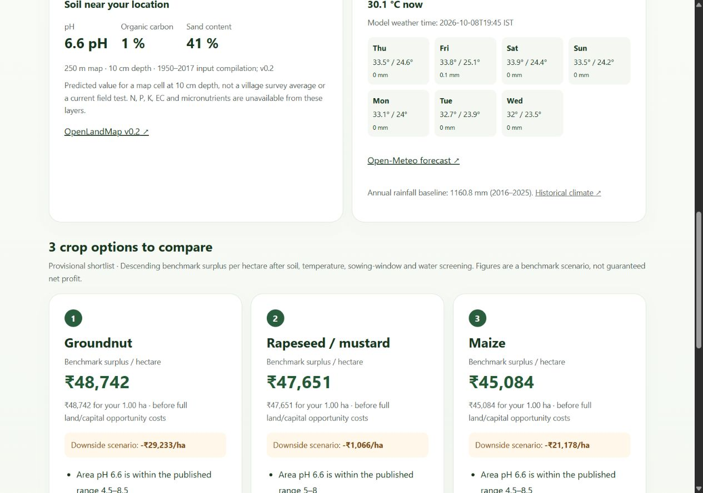
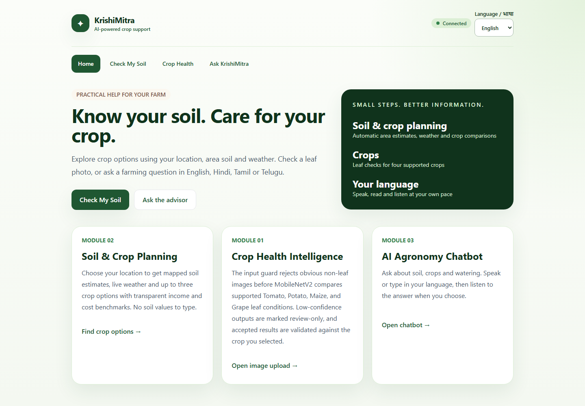
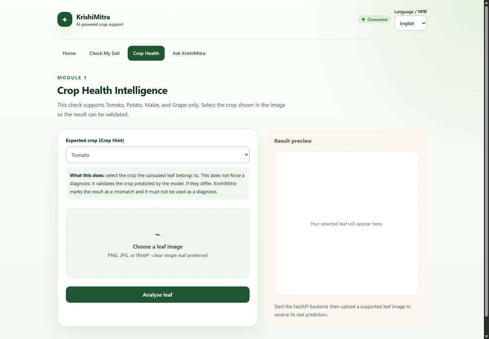
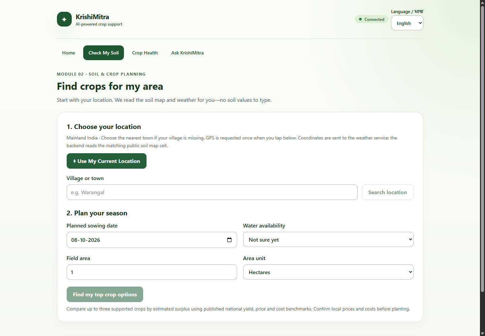
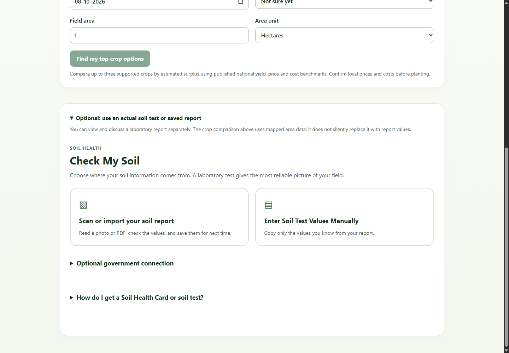

# KrishiMitra Final Project Report

**Agricultural decision support using leaf analysis, mapped soil and weather, and a multilingual advisor**  
**Project I | Academic year 2026–2027 | Technical status: 8 October 2026**

Institution: VIT Chennai  
School: SCOPE (School of Computer Science and Engineering)  
Department: Computer Science  
Guide: Premalatha M  
Students: Kaavya Gupta (23BCE1986); A Praveen (23BCE1648); Shivom Shrivastava (23BCE1983)

> This is an editable technical report. Signatures, institutional certificate wording and guide approval must be completed before submission. No signature or institutional approval is asserted here.

<!-- PAGEBREAK -->

## Bonafide Certificate

Draft for institutional review: the project titled **KrishiMitra: Agricultural Decision Support Using Leaf Analysis, Mapped Soil and Weather, and a Multilingual Advisor** was carried out by **Kaavya Gupta (23BCE1986), A Praveen (23BCE1648), and Shivom Shrivastava (23BCE1983)** of the Department of Computer Science, SCOPE, VIT Chennai, under the guidance of **Premalatha M** during academic year **2026–2027**. The guide and institution should verify the project title, work period and required certificate wording before signing.

Guide name and signature: ______________________________  
Head of department and seal, if required: ______________________________  
Date: ______________________________

## Student Declaration

The undersigned students, **Kaavya Gupta, A Praveen and Shivom Shrivastava**, should confirm after review that this report describes their own project work; that externally sourced code, datasets, models and publications are acknowledged; and that the report has not been submitted elsewhere contrary to institutional rules. The technical claims in this draft are based on the current repository and recorded evidence; the students remain responsible for the final submission.

Student signatures and date: ___________________________________________

## Acknowledgement

The team acknowledges **Premalatha M** for project guidance and the Department of Computer Science, SCOPE, VIT Chennai, for the academic setting. The implementation uses public research and data from PlantVillage, FAO, OpenLandMap, Open-Meteo and Indian government publications, attributed in the references. This acknowledgement is a draft for the students' review.

## Abstract

KrishiMitra combines three agricultural support functions in a React and FastAPI application. A MobileNetV2 pipeline classifies ten supported healthy/diseased leaf classes; a location-based planner reads mapped soil properties and weather before screening nine crops; and a Gemini-backed advisor accepts typed or recorded questions in four languages. The planner compares up to three eligible crops using published national yield, minimum support price and A2+FL cost benchmarks. Soil map values are estimates, while report-imported values keep their own provenance. PostgreSQL stores conversations and scan metadata; credentials stay on the server.

The recorded PlantVillage experiment reports 98.63% test macro-F1 on controlled images, but the trained checkpoint is absent from this checkout and that score does not establish field-photo accuracy. The current software test suite passed 87 backend and 37 frontend tests; server speech transcribed a synthetic recording in a live API smoke test. The planner has also been exercised against public services at three Indian locations. The system is a decision-support prototype: its shortlist is neither a farm-specific profit forecast nor a fertilizer prescription.

**Keywords:** plant disease classification; digital soil mapping; crop planning; agricultural decision support; speech interface.

<!-- PAGEBREAK -->

## Table of Contents

1. Introduction ................................................................ 4  
2. Literature and Patent Review ............................................. 4  
3. Methodology and System Design ............................................ 5  
4. Implementation and Results ............................................... 8  
5. Conclusion and Future Work .............................................. 10  
References ................................................................. 10  
Appendices ................................................................. 11

## List of Figures

Figure 1. Layered runtime architecture and trust boundaries ............. 5  
Figure 2. Location-to-crop planning sequence ............................ 6  
Figure 3. Soil, weather and crop comparison screen ....................... 9  
Figure 4. Home screen and module navigation ............................ 12  
Figure 5. Crop-health upload and crop-hint screen ....................... 12  
Figure 6. Location and season input screen ............................. 13  
Figure 7. Optional soil-report choices ................................. 13  
Figure 8. Advisor and server-recording screen .......................... 14

## List of Tables

Table 1. Existing approaches and project gap ............................ 4  
Table 2. Component responsibilities and contracts ....................... 6  
Table 3. Modules and implementation status ............................. 8  
Table 4. Verification evidence and interpretation ....................... 9  
Table 5. Principal API routes ......................................... 11

## Abbreviations

**A2+FL** actual paid-out costs plus imputed family labour; **API** application programming interface; **COG** cloud-optimised GeoTIFF; **EC** electrical conductivity; **FAO** Food and Agriculture Organization; **KVK** Krishi Vigyan Kendra; **MSP** minimum support price; **OCR** optical character recognition; **SHC** Soil Health Card; **STT/TTS** speech-to-text/text-to-speech.

<!-- PAGEBREAK -->

# Chapter 1 Introduction

## 1.1 Background and problem

Farmers often need separate tools for identifying visible leaf symptoms, interpreting soil information, assessing seasonal crop options and asking questions in a familiar language. A leaf photograph alone cannot establish a field diagnosis; a Soil Health Card may not be available; and national crop prices do not predict farm profit. KrishiMitra places these inputs in one interface while keeping their uncertainty and provenance visible. The problem addressed is access to useful *preliminary* information, not replacement of a laboratory test, market enquiry or local agronomist.

## 1.2 Objectives, scope and expected outcomes

The objectives are to: (i) classify only ten supported leaf-condition labels and flag uncertain or mismatched cases; (ii) avoid repeated manual soil entry by reading pH, organic carbon and sand from a public map after location selection; (iii) combine weather and published crop requirements to show an explainable shortlist and benchmark economics; and (iv) support editable voice/text questions in English, Hindi, Tamil and Telugu. The scope covers a local Windows demonstration with React, FastAPI and PostgreSQL. The planner is restricted to mainland India and a nine-crop catalogue. Government SHC lookup is an optional authorized adapter, not the default source; no approved public GPS-to-SHC lookup or nutrient-inference model is claimed.

The expected outcome is a reproducible software prototype whose outputs are labelled by source and limitation. The report proceeds from prior work (Chapter 2), through the actual architecture and methods (Chapter 3), to tested functionality and results (Chapter 4), then remaining validation and deployment work (Chapter 5).

# Chapter 2 Literature and Patent Review

## 2.1 Existing work and comparison

PlantVillage provides a large curated leaf-image research corpus [1]. MobileNetV2 uses inverted residual blocks and linear bottlenecks to support relatively efficient visual inference [2]. Both inform Module 1, but curated leaf photographs differ from unconstrained farm images; controlled-set metrics cannot be transferred to field conditions without external validation. FAO ECOCROP provides broad environmental ranges rather than district calendars or cultivar-specific yield predictions [3]. OpenLandMap provides gridded *predictions* of soil attributes [4], while Open-Meteo supplies model weather and ERA5 historical series [5]. Indian agricultural statistics and MSP/cost announcements supply transparent economic reference values [6–8]. Gemini supports audio understanding [9], but response fluency is not evidence of agronomic correctness.

| Approach | Strength | Limit addressed by this project |
|---|---|---|
| Standalone leaf classifier | Rapid supported-label comparison | Add crop mismatch, uncertainty, image checks and explicit field-validation limits. |
| Manual/authorized SHC workflow | Can preserve measured values and units | Offer map-based approximate context when the farmer has no card; never relabel map values as laboratory results. |
| Generic crop recommender using user-entered NPK | Simple tabular prediction | Read available mapped attributes automatically and leave unavailable N/P/K unknown. |
| Generic weather or chatbot application | Accessible forecasts or conversation | Connect weather to visible screening rules, and keep answer and speech uncertainty explicit. |

**Table 1.** Existing approaches and the project gap.

The integrated contribution is a source-aware workflow: soil estimate, climate screening, benchmark economics and optional conversational explanation are presented together without conflating measured, mapped and generated data. No patent claim has been made, and no freedom-to-operate patent search was performed. A formal patent review belongs to any later commercialization process.

# Chapter 3 Methodology and System Design

## 3.1 Design goals and runtime architecture

The design separates presentation, API validation, domain logic, provider access and persistence (Figure 1). This keeps a model-generated answer distinct from a measured soil result, and it permits the crop planner to report partial source failure without inventing inputs. The React/TypeScript application runs in the browser; its four views share language and connection state, while the planner, soil-report reader and advisor are loaded as needed. Browser speech capture and report OCR require a user's action. Versioned FastAPI routes accept typed requests and invoke separate leaf, planning, soil and advisor services. The local demonstration serves the API on port 8000 and Vite on port 5173; Compose supplies PostgreSQL, not the complete application stack.

The **browser-to-server boundary** carries JSON for ordinary requests, multipart image uploads and bounded WAV audio. The **server-to-provider boundary** carries selected coordinates to weather/geocoding services, limited raster reads to OpenLandMap and advisor/audio requests to Gemini. The Gemini key, signing secret and optional image weights remain server-side. PostgreSQL stores conversations and scan metadata; it also has a pgvector knowledge-document schema, but citation-grounded retrieval is not connected to the present chatbot. This diagram describes implemented components and optional components separately.

**Figure 1. Layered runtime architecture and trust boundaries.**

<!-- PAGEBREAK -->

## 3.2 Component contracts and ownership

| Component | Owned responsibility | Contract and failure behaviour |
|---|---|---|
| Browser presentation | Navigation, location/date/water/area entry, leaf preview, report OCR review, editable voice transcript | Sends explicit user selections; cancels stale requests; shows unavailable source and uncertainty states. |
| FastAPI boundary | `/api/v1` routing, Pydantic validation, request-size/rate limits, CORS and controlled errors | Rejects invalid coordinates, dates, payloads and oversize audio/images before domain processing. |
| Domain services | Image guard/inference; crop eligibility and economics; soil interpretation; advisor/translation/STT | Return typed results with warnings, provenance and uncertainty; optional model absence is reported, not disguised. |
| Provider adapters | Open-Meteo geocoding, forecast and ERA5; OpenLandMap COG cell reads; Gemini | Validate units, dates, ranges and no-data; use bounded requests and provider-specific unavailable states. |
| Persistence | PostgreSQL conversations and scan metadata; local reviewed-report storage | Holds no raw uploaded leaf or recording in the application's database; signed continuation limits reuse. |

**Table 2.** Component responsibilities and observable contracts. These are logical ownership boundaries inside the current frontend and backend, not independently deployed microservices.

## 3.3 Location-to-crop request sequence

The farmer searches for a town or grants GPS, then confirms one location. The frontend submits latitude, longitude, sowing date, irrigation category and area in hectares. `PlanRequest` constrains coordinates, a 0–365-day future date and positive area up to 10,000 ha. The backend checks mainland-India coverage, then reads mapped soil, seven-day weather and ten complete years of ERA5 climate concurrently. The OpenLandMap adapter reads one cell from each of three 250 m, 10 cm-depth COG layers by HTTP range rather than downloading global rasters. The provider layer validates units and missing values before returning a source-labelled object.

The planner requires mapped pH and historical climate to rank. It screens the nine catalogued crops by sowing month, pH, four monthly temperature means and water conditions before sorting eligible crops by benchmark surplus per hectare. It returns at most three cards plus excluded crops, explanations and source URLs. A missing forecast adds a caution; missing pH or climate yields `insufficient_data`. The frontend renders those states instead of a synthetic recommendation. Figure 2 captures this sequence and its failure branch.

**Figure 2. Location-to-crop planning sequence and failure branch.**

## 3.4 Module methods

**Module 1, leaf analysis.** The pipeline uses a 10-class PlantVillage subset across tomato, potato, maize and grape. The recorded split contains 7,427 training, 1,591 validation and 1,591 test images [10]. The training script applies image augmentation only to training data, uses 224×224 normalized input, selects the MobileNetV2 checkpoint by validation macro-F1 and evaluates the independent test split. The API bounds upload size and image decoding, rejects obvious non-leaf inputs, reports low-confidence output as tentative and flags disagreement with the crop selected by the user. It records a hash and prediction metadata, not the uploaded image. The model checkpoint is missing locally; this checkout cannot currently run genuine leaf inference until that artefact and optional Torch packages are restored.

**Module 2, location-based planning.** The user selects a place or explicitly grants GPS once, then supplies sowing date, water availability and area. Rasterio reads one 250 m OpenLandMap map cell at 10 cm depth for pH, organic carbon and sand; it does not download an entire global raster. Missing/no-data values stay unknown. Open-Meteo gives current/seven-day model weather and an ERA5 baseline from ten complete calendar years. A nine-crop catalogue stores reviewed FAO pH, temperature and annual-rainfall ranges, indicative sowing months, national yields and dated MSP/A2+FL costs [3–8]. Candidate crops must pass the catalogue's sowing window, mapped-pH absolute range, each of four monthly temperature absolute ranges and the four-month optimal-mean range. A dry month below the application's 30 mm screening threshold, or annual rain below the crop range, excludes rainfed choices; irrigation-dependent choices carry a caution. The threshold and four-month window are application heuristics, not validated local crop-water models. Near-term forecast extremes add cautions, not a long-term forecast.

For each passing crop, kilograms per hectare are converted to quintals per hectare; the result is multiplied by MSP minus the national A2+FL cost per quintal. Ranking uses this **benchmark surplus per hectare** and displays at most three passing crops. The downside example assumes 25% lower yield, 20% lower price and 20% higher cultivation cost. It is a scenario, not a confidence interval. If pH or historical climate is unavailable, no ranking is produced. Map carbon and sand are context only; N/P/K, EC and micronutrients are not inferred.

**Module 3, advisor and voice.** The backend holds the Gemini key and sends an agricultural question plus recent conversation context to the configured model. Server recording captures at most 30 seconds as bounded WAV, calls Gemini for transcription and returns editable text before the user sends a question. Browser recognition is an explicit fallback; local speech synthesis provides playback where voices exist. Backend translation supports four interface languages and protects numbers/units through placeholder checks. The advisor refuses fabricated numerical application quantities and can explain a signed, user-reviewed soil profile deterministically. It remains a general LLM advisor rather than a validated citation-grounded expert system.

**Optional soil-report path.** A farmer can import a photo/PDF or paste a report; client-side text extraction/OCR proposes values for review. Saved reports require local consent. The manual form keeps units, date and source labels. An SHC GraphQL adapter exists but requires approved credentials and confirmed units, so public map values are not represented as SHC data.

## 3.5 Data, reliability and protection design

React 18, TypeScript, Vite, TanStack Query and Vitest implement the UI; FastAPI, Pydantic, SQLAlchemy, Alembic, httpx and Rasterio implement the API; PostgreSQL/pgvector provides persistence. Source identity travels with values: mapped pH/carbon/sand are labelled estimates, forecast and historical climate are separate products, and yield/MSP/A2+FL values are dated national benchmarks. A reviewed report remains a distinct measured-data path and does not silently overwrite the planner's map inputs. No N/P/K, EC or micronutrient values are inferred from the selected public layers.

Provider reads have bounded sizes and timeouts. Per-process caches use 24-hour TTLs for places, soil and climate, 30 minutes for forecasts, and coalesce identical reads. Input limits, a local rate limiter, explicit CORS origins, signed continuation and Git-ignored `.env` secrets form the current protection boundary. Production still needs shared quotas, key rotation, monitoring and privacy review. Logs omit request bodies, audio and coordinates; no security certification is claimed.

<!-- PAGEBREAK -->

# Chapter 4 Implementation and Results

## 4.1 Functional completion and integration

| Module or service | Implemented behaviour | Evidence and current condition |
|---|---|---|
| Leaf analysis | Upload checks, model adapter, metadata persistence and tentative/mismatch states | API regression passes; trained weights/Torch absent here, so live inference is unavailable in this checkout. |
| Soil and crop planner | Location search/GPS, map/weather reads, eligibility screen, top-three benchmark comparison | Live source requests returned usable values at Warangal, Ludhiana and Coimbatore; no field-validity study. |
| Soil report | Manual entry, local OCR/PDF import and reusable reviewed reports | Component and API tests pass; OCR still requires human correction. |
| Advisor and speech | Gemini chat, translation, server STT and user-controlled playback | Configured Gemini key accepted; synthetic spoken WAV returned its transcript through `/speech/transcribe`. Real farmer speech not measured. |
| Persistence and deployment | PostgreSQL conversations, scans and migrations; local Windows launcher | Database/launcher smoke test passed. Compose supplies the database only; frontend/backend run as local processes. |

**Table 3.** Modules and implementation status as checked on 8 October 2026.

The end-to-end farmer route for Module 2 is: choose location, view mapped soil and weather, choose sowing/water/area, then inspect ranked cards, cautions, underlying prices/yields and exclusions. A failed live provider displays an unavailable state. The app did not invent substitute soil or weather data during a transient outage; a later retry recovered. Module 1's historical experimental record is not equivalent to a currently loadable deployed model.

## 4.2 Testing, metrics and interpretation

| Verification | Result | Interpretation |
|---|---|---|
| Backend automated suite | 87 tests passed | Covers route validation, provider failure, dates/units, soil provenance, speech, security and ranking logic. |
| Frontend automated suite | 37 tests passed; TypeScript and Vite build passed | Covers forms, cancelled/stale requests, missing sources, voice states, report import and recovery UI. |
| PlantVillage recorded independent test | Accuracy 98.68%; macro-F1 98.63%; CPU p50/p95 40.85/43.52 ms [10] | Metadata from an earlier controlled-image experiment; checkpoint and full test artefacts are absent here. No field accuracy claim. |
| Live Module 2 smoke test | Three Indian locations returned soil, forecast, climate and provisional options | Confirms integration on those requests, not crop suitability or economic return. |
| Live server speech smoke test | One synthetic WAV transcript matched its spoken sentence | Confirms configured API/audio route; no multilingual or noisy-field recognition metric. |
| Responsive and dependency checks | No horizontal overflow at 390/1280 px; frontend production audit reported zero known vulnerabilities at test time | Limited UI and package check, not a complete accessibility or security audit. |

**Table 4.** Verification evidence and its limits. Test counts are from the current checkout; the PlantVillage metric is from the checked-in model registry. The class distribution is uneven (for example, 23 potato-healthy versus 286 tomato-late-blight test images), so macro-F1 is more informative than accuracy alone. The test set still shares controlled collection conditions with development data. There is no measured on-farm profit error, map-versus-lab soil error, multilingual word-error rate or blinded agronomist assessment.

## 4.3 Observed comparison and limitations

The report uses comparisons appropriate to available evidence. A common NPK classifier needs nutrient inputs that the selected public map layers do not supply, so such a dataset was not used to fabricate automatic recommendations. SoilGrids' public REST availability was insufficient during implementation; bounded OpenLandMap COG reads provided a working alternative, with explicit map-estimate labels [4]. ERA5 replaced an ERA5-Land response with null rain values. A simple profit ordering before screening could rank a warm-season crop in a cool location; the final implementation applies temperature and water checks before the surplus sort. These comparisons explain engineering choices; none proves agronomic optimality.

**Figure 3. Soil, weather and crop comparison screen.** The image is a documented smoke-test view and displays benchmark figures, not a recommendation for the pictured locality.

<!-- PAGEBREAK -->

# Chapter 5 Conclusion and Future Work

The completed prototype joins leaf-image safeguards, automatic mapped-soil and weather retrieval, a transparent nine-crop comparison, report import and a multilingual advisor behind one application. Tests and selected live calls support the software-integration claim. They do not support claims of field diagnosis, measured area nutrients, guaranteed top-profit crops or validated fertilizer dosing. Module 1 needs its trained artefact restored for a live demonstration, and its controlled-image performance needs field testing.

Before farmer deployment, prioritize district/variety crop calendars and agronomist review; local multi-year yields, sale prices and cultivation/transport costs with out-of-time evaluation; map-versus-laboratory soil validation; real multilingual speech and translation assessment; and production deployment controls including provider licensing, shared quotas, monitoring and a complete container stack. The equal team-contribution statement and unsigned preliminary pages should be reviewed and signed as required before academic submission.

# References

[1] Hughes, D. P., and Salathé, M. “An open access repository of images on plant health to enable the development of mobile disease diagnostics,” 2015. https://arxiv.org/abs/1511.08060

[2] Sandler, M., et al. “MobileNetV2: Inverted Residuals and Linear Bottlenecks,” CVPR, 2018. https://openaccess.thecvf.com/content_cvpr_2018/papers/Sandler_MobileNetV2_Inverted_Residuals_CVPR_2018_paper.pdf

[3] FAO. “ECOCROP: Database of crop constraints and characteristics.” https://www.fao.org/geospatial/data-and-tools/data-portals/ecocrop/en

[4] OpenGeoHub. “OpenLandMap layers and documentation.” https://docs.openlandmap.org/016-project.html

[5] Open-Meteo. “Historical Weather API” and forecast/geocoding documentation. https://open-meteo.com/en/docs/historical-weather-api ; https://open-meteo.com/en/docs

[6] Government of India. *Agricultural Statistics at a Glance 2024–25*, Table 2.1, printed p. 40. https://nccd.gov.in/uploads/Agricultural_Statisitcs_at_a_Glance_2024_25_11da3cd37d.pdf

[7] Press Information Bureau. “Cabinet approves Minimum Support Prices for Kharif Crops for Marketing Season 2026–27.” https://www.pib.gov.in/PressReleasePage.aspx?PRID=2260617

[8] Press Information Bureau. “Cabinet approves Minimum Support Prices for Rabi Crops for Marketing Season 2027–28.” https://www.pib.gov.in/newsite/erelcontent.aspx?lang=2&reg=3&relid=295517

[9] Google AI for Developers. “Audio understanding” and “Using Gemini API keys.” https://ai.google.dev/gemini-api/docs/audio ; https://ai.google.dev/gemini-api/docs/api-key

[10] KrishiMitra repository. `docs/model_registry/mobilenetv2-10class-v1.json` and `data/splits/plantvillage_10class.summary.json`, checked 8 October 2026. The original training corpus and checkpoint are not included in this checkout.

[11] Natural Earth. “Admin 0 countries, 1:110m.” https://github.com/nvkelso/natural-earth-vector

External URLs were checked on 8 October 2026. Static government years, API terms and data availability should be rechecked before submission or deployment.

<!-- PAGEBREAK -->

# Appendices

## Appendix A Principal routes and run procedure

| Route | Purpose and boundary |
|---|---|
| `POST /api/v1/health/predict` | Bounded supported-image inference; requires model artefact/Torch and database. |
| `GET /api/v1/planning/locations` | Search India place names; does not select an ambiguous result for the user. |
| `POST /api/v1/planning/recommend` | Validated location/date/area/water input; returns map/weather evidence, exclusions and at most three provisional crops. |
| `POST /api/v1/soil/manual` | Validate reviewed soil values and units; separate from mapped planning values. |
| `POST /api/v1/speech/transcribe` | Up to 30 seconds of WAV; uses server-side Gemini key. |
| `POST /api/v1/advisor/chat` | Agriculture question, controlled context and stored answer; no verified retrieval citations. |

**Table 5.** Principal API routes. The current Windows entry point is `Start-KrishiMitra.cmd` at the repository root. It starts PostgreSQL via Compose, applies Alembic migrations and serves backend on port 8000 and frontend on port 5173. Place the Gemini key only in Git-ignored `backend/.env`. Module 2 does not need this key; server speech and chat do. Detailed setup and data refresh steps are in `README.md`, `docs/module-2.md` and `docs/soil-and-voice-setup.md`.

## Appendix B Demonstration and evidence checklist

Demonstrate: (1) select a location and explain why map pH is not a field test; (2) change water/date and inspect exclusions, sources and benchmark economics; (3) import a soil report and correct an OCR value; (4) show speech status, record a question, correct the transcript and submit; (5) show one unsupported-image rejection and, only after restoring the trained checkpoint, an actual leaf prediction. Existing evidence includes the Module 2 screenshot in `docs/screenshots/module-2-results.jpg`, the test suites in `backend/tests/` and `frontend/src/test/`, the planning source checksums and model registry. No publication, patent application or field trial is claimed.

## Appendix C Individual contribution and guide feedback

**Equal joint contribution (team statement):** Kaavya Gupta (23BCE1986), A Praveen (23BCE1648), and Shivom Shrivastava (23BCE1983) report that they worked equally across the project. No module or numerical share is attributed to one member without a verified record. For the review, the team should be ready to explain the architecture, methods, implementation, testing and limitations individually. Dated guide feedback and any requested corrections can be added here after guide review. The current repository documents corrections to speech configuration, automatic soil access, crop-screening rules, source attribution and startup reliability.

## Appendix D Suggested viva questions

**Why is 98.63% not field accuracy?** It comes from a controlled PlantVillage split; field lighting, backgrounds, varieties and devices were not independently assessed. **Why no NPK estimate?** The deployed map layers do not provide plant-available N/P/K with matching methods and units. **Why is the top crop not guaranteed most profitable?** The ranking covers nine screened crops and uses national yield/MSP/A2+FL benchmarks, not actual local yields, sale price and full costs. **What happens when a provider fails?** Missing mapped pH or historical climate blocks ranking; a weather outage is labelled; no synthetic measurement is substituted. **Where is the Gemini key?** Only in the server's Git-ignored environment file, never the browser bundle.

## Appendix E Interface screenshots

The following screenshots were captured from the running local frontend on 8 October 2026. They document visible UI states, not completed transactions or a field-use study. Figure 3 above records the planner's populated results; Figures 4–8 show navigation and input paths.

**Figure 4. Home screen and module navigation.** The entry view exposes all three modules and the connection indicator.

**Figure 5. Crop-health upload and crop-hint screen.** The empty upload state shows supported crops and the mismatch safeguard; no live diagnosis is implied.

**Figure 6. Location and season input screen.** The user chooses a place, sowing date, water state and area; soil values are not typed into this planner.

**Figure 7. Optional soil-report choices.** The laboratory-report path stays separate from mapped area data used for the crop comparison.

**Figure 8. Advisor and server-recording screen.** Speech is transcribed to editable text before a question is submitted.

**Screen-to-service trace.** The home header polls `/api/v1/health` to show API reachability. The crop-health screen posts an image and explicit crop hint to `/api/v1/health/predict`; its empty state makes no model claim. The planning form uses `/api/v1/planning/locations` for place search and `/api/v1/planning/recommend` for one validated location, season and water request. The optional soil-report panel opens a separate local OCR/review path, and reviewed values can be submitted to the soil API without changing the map-based planner input. The advisor checks server speech availability, posts a bounded recording to `/api/v1/speech/transcribe`, then lets the farmer correct text before `/api/v1/advisor/chat`. These interactions follow the trust boundaries in Figure 1.
